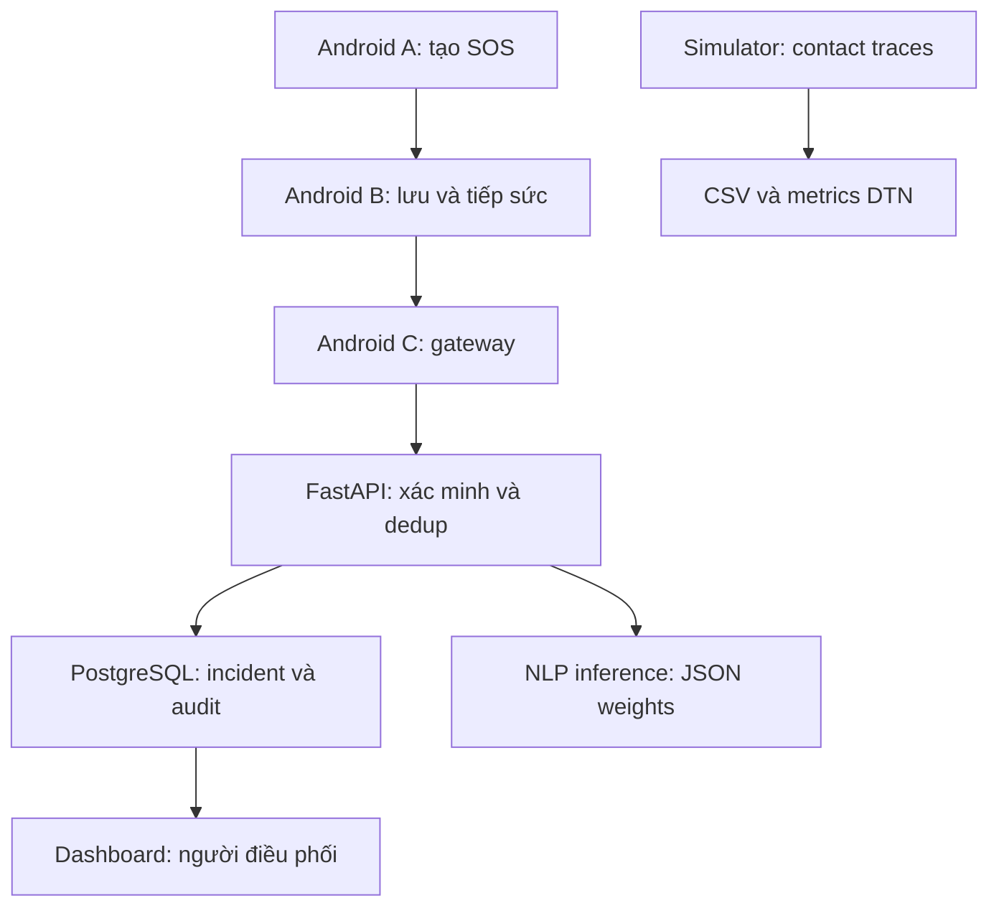

# RescueLink v0.2 — MVP nghiên cứu

**Xây dựng và đánh giá hệ thống hỗ trợ cứu hộ thiên tai sử dụng mạng P2P/DTN và AI phân loại yêu cầu khẩn cấp**.

Flutter Android + Nearby Connections + SQLite → gateway → FastAPI/PostgreSQL + NLP → React/MapLibre. Dùng cho diễn tập đồ án nhóm 2 người. **Mở `docs/START_HERE.md` trước**: hướng dẫn từng ứng dụng, Windows/Ubuntu VM, Redmi, cập nhật v0.1 và lỗi NDK.

## Có trong mã nguồn

| Thành phần | Chức năng |
|---|---|
| Android | Tạo SOS text/GPS/needs/số người; SQLite bền vững; khóa ECDSA P-256 trong Keystore |
| Offline DTN | Nearby P2P_CLUSTER; xác nhận mã trên hai máy; inventory/dedup; ACK sau lưu; TTL/hop; ưu tiên 5:3:1; buffer bounded 1.000 tin |
| Gateway | Retry idempotent, kiểm receipt đúng ID, exponential backoff 15–300s + jitter; sync thủ công bypass backoff |
| Backend | Xác minh chữ ký/body/hash, expired reject, token operator/gateway tách biệt; quota 30 SOS mới/khóa/giờ; optimistic locking và audit |
| AI | TF-IDF + Logistic Regression train/evaluate/export JSON/inference; fallback rules; người xác minh quyết định |
| Dashboard | Phân trang, tìm/lọc trong trang; map/heatmap; số liệu toàn DB; xác minh/phân công/hoàn tất; điều chỉnh priority với lý do; CSV; AI preview |
| Đánh giá | Simulator Epidemic/binary Spray-and-Wait; trace paired 10 seeds ở 30/50/100 nodes; Android JSONL export và script tổng hợp |
| Chất lượng | 37 automated tests, TypeScript build, CI API/AI/simulator/dashboard; hướng dẫn thực địa và tiêu chí nghiệm thu |

## Khởi động server (Ubuntu Terminal)

```bash
python3 scripts/setup.py
sudo docker compose up -d --build
sudo docker compose ps
curl http://localhost:8080/api/health
```

Mở Chrome `http://localhost:8080` trên máy server, hoặc `http://IP:8080` từ máy cùng LAN đã kết nối được. ADMIN_TOKEN trong `.env` dùng trên web; DRILL_KEY chỉ dùng gateway. Không commit/chia sẻ `.env`. Docker không publish cổng DB; nginx publish 8080 và proxy `/api`.

Seed 3 tin test (không phải tin truyền từ điện thoại):

```bash
sudo docker compose cp scripts/seed_demo.py api:/tmp/seed_demo.py
sudo docker compose exec api python /tmp/seed_demo.py --url http://127.0.0.1:8000
```

`docker compose down` giữ DB; không dùng `down -v` khi muốn giữ dữ liệu. Schema v0.2 tương thích v0.1. AI đã lưu trên tin cũ không tự bị thay đổi.

Không Docker: Python3.12, `pip install -r backend/requirements.txt`, `python scripts/setup.py`, `python scripts/dev_api.py`; terminal khác `cd dashboard`, `npm ci`, `npm run dev`. Vite proxy API loopback. Development dùng SQLite, Docker dùng PostgreSQL.

## Android (PowerShell trên Windows)

```powershell
python scripts\bootstrap_mobile.py
cd mobile
flutter pub get
flutter analyze
flutter devices
flutter run -d MA_THIET_BI
```

Bootstrap chỉ lần đầu, tạo wrapper bằng Flutter có sẵn rồi chép overrides. Đã có mobile/android: dùng `python scripts\update_mobile.py` từ gốc để sao lưu và cập nhật. AGP9/built-in Kotlin cần Flutter>=3.47; AGP8 dùng KGP>=2.0. Cài NDK đúng version Flutter yêu cầu, không hạ version ngẫu nhiên. Android8+ có Play services; không hỗ trợ target Windows/Web/iOS.

## Kiến trúc



Chữ ký bao phủ đúng bytes `body_b64` với domain prefix, SHA256 tạo message_id. Metadata hop nằm ngoài chữ ký để relay chuyển tiếp. Nội dung nguồn bất biến; priority điều phối là cột riêng `effective_priority`, cập nhật tăng version và lưu audit. Không dùng Hash(User_ID + Timestamp) vì không bao phủ nội dung và có thể collision khi timestamp trùng.

NLP gợi ý mức `min(mức khai báo, mức model/hàng chờ, safety rules)`, không tự ghi đè mức điều phối. Thông tin nguy hiểm hoặc nhu cầu y tế có thể được nâng ưu tiên để người trực kiểm tra; từ khóa có thể hiểu sai phủ định. Điểm softmax chưa calibrated. Model text-only macro-F1=0,759 trên **test tổng hợp 54 câu**, recall P1=0,611; chưa đủ cho tự động dispatch. Xem `ai/README.md`, `docs/EVALUATION.md`.

## Kiểm thử và tái lập

```bash
python -m pip install -r backend/requirements.txt -r ai/requirements.txt
python ai/train.py
python -m pytest backend/tests simulation/test_dtn.py scripts/test_mobile_config.py -q
python simulation/dtn.py --nodes 100 --seeds 10 --out simulation/results/repeated100
```

Trước pytest đặt PYTHONPATH:
- Ubuntu: `export PYTHONPATH=backend`
- PowerShell: `$env:PYTHONPATH="backend"`

Dashboard: `cd dashboard`, `npm ci`, `npm run build`. AI artifact đã kèm, train lại không bắt buộc để khởi động. Khi đổi model, chép sang `backend/models` rồi rebuild Docker API. Github Actions chưa được chạy từ GitHub trong lần bàn giao này.

## Giới hạn phải ghi trong báo cáo

Đã chạy kiểm thử API bằng SQLite, simulator và build web; **chưa build APK v0.2 hoặc đo P2P/pin trên điện thoại**, chưa thử Docker/PostgreSQL integration trong môi trường tạo mã. Không gán tỷ lệ hoàn thiện 100% khi chưa đạt thực địa.

- Android dùng bounded Epidemic + weighted priority; Spray-and-Wait chỉ simulator so sánh. Không có BLE Mesh chuẩn, bridge iOS hay mesh IP. Simulator contact ngẫu nhiên không dự đoán phủ sóng thực địa, không mô phỏng radio/energy.
- Chỉ text/GPS; không có ảnh/audio/CV/PhoBERT/routing đường/quản lý kho. Các mục này ngoài MVP trong `BACKLOG.md`.
- Chưa E2EE: relay đọc được nội dung. Nearby bảo vệ connection không thay thế E2EE; chữ ký chỉ chứng minh khóa nguồn, không chứng minh người thật/SOS thật. Không chống Sybil hoàn toàn.
- HTTP debug LAN, release cần HTTPS; receipt server chưa ký/gossip. Đánh dấu received tại gateway không bảo đảm người nguồn được cập nhật.
- Token admin chung, chưa RBAC/per-user accounts. Quota PostgreSQL serialized bằng advisory lock; SQLite development không cam kết quota chính xác khi ingest đồng thời. Không publish bản này ra Internet với dữ liệu thật.
- Foreground service do người dùng bật; không tự sống lại sau force-stop/reboot. Discovery còn chạy trong phiên nên hao pin cần đo; tắt relay khi kết thúc diễn tập.
- TTL theo giờ thiết bị, đồng bộ UTC trước test; hop metadata chưa chống peer cố tình giảm hop. Bảo vệ tin own không tự xóa; đủ 1.000 own cần quy trình archive trước khi dùng lâu dài.
- Dashboard polling5s, filtering/heatmap theo trang100 tin; thống kê tổng DB độc lập. CSV tối đa10.000. Không gọi giao nhận offline là real-time được bảo đảm.

## Tài liệu

`docs/START_HERE.md`: chạy/cập nhật; `ANDROID.md`: radio/GPS/quyền; `PROTOCOL.md`: wire format; `FIELD_TEST.md`: đo thật; `EVALUATION.md`: số liệu; `VERIFICATION.md`: phạm vi đã kiểm tra; `BACKLOG.md`: nghiệm thu; `ai/README.md`: model card/dữ liệu; `simulation/results`: raw CSV/JSON.
